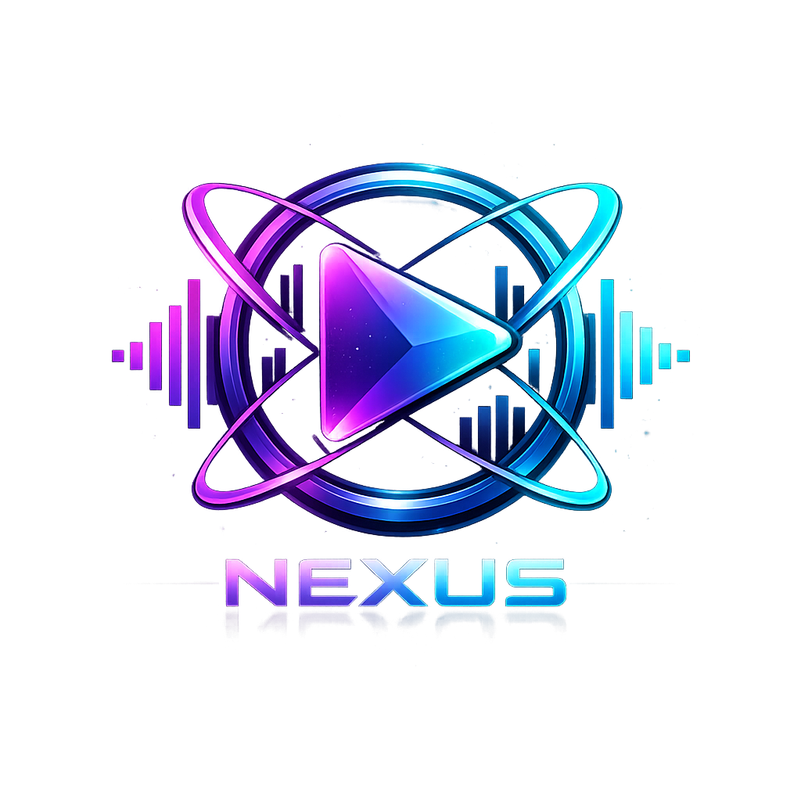
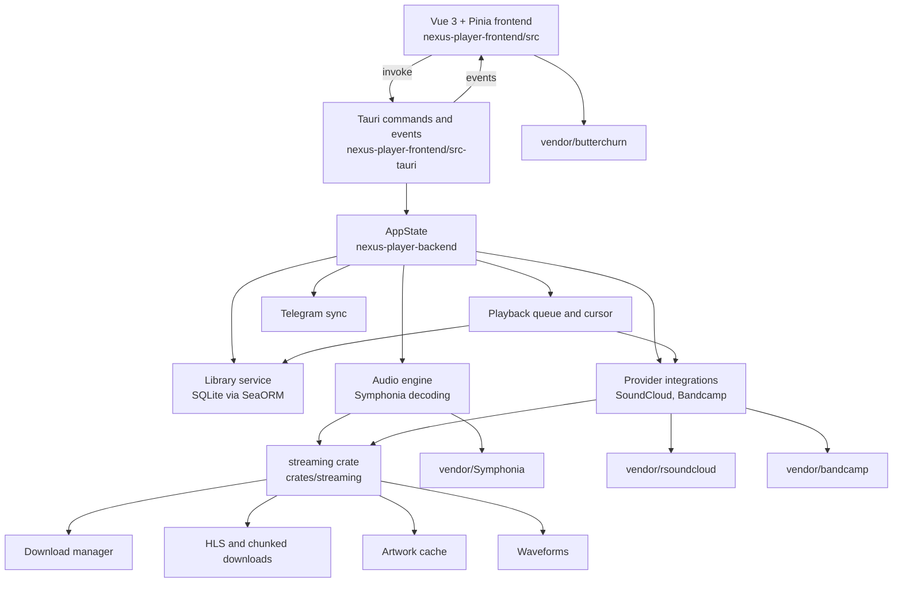

<p align="center">
  
</p>

# Nexus Player

Nexus Player is a desktop and Android music player built with Rust, Tauri 2 and Vue 3. It plays a local library and streams from SoundCloud and Bandcamp.

## Architecture



## Notable engineering decisions

### Cursor-based playback queue

Playback does not hold a flat list of tracks. A [`PlayerCursor`](nexus-player-backend/src/playlist/cursor/engine.rs) keeps a stack of lazy `CursorSource`s and walks nested content depth-first, asking each source for the next batch only when needed. A source can yield a track or a container (a playlist, a radio session, a search), and containers are resolved into new sources on demand. [`playback_queue.rs`](nexus-player-backend/src/playlist/playback_queue.rs) builds the queue on top of the cursor: history, a manual queue, repeat modes and shuffle inside a prefetch window. Code is in [`playlist/cursor/`](nexus-player-backend/src/playlist/cursor) and [`playback_queue.rs`](nexus-player-backend/src/playlist/playback_queue.rs).

### HLS and chunked streaming

Remote audio is read through two paths. HLS streams are parsed and fetched segment by segment in [`crates/streaming/src/hls/`](crates/streaming/src/hls) and held in [`buffers/hls.rs`](crates/streaming/src/buffers/hls.rs); plain HTTP audio is held in fixed-size chunks in [`buffers/chunked.rs`](crates/streaming/src/buffers/chunked.rs). On the backend side, [`hls_decoder.rs`](nexus-player-backend/src/audio/hls_decoder.rs) decodes HLS segments with Symphonia through [`hls_reader.rs`](nexus-player-backend/src/audio/playback/hls_reader.rs), which adapts the segment source to a seekable reader, and [`chunked.rs`](nexus-player-backend/src/audio/chunked.rs) provides a seekable media source that caches chunks fetched over HTTP.

### Download manager

[`state/manager.rs`](crates/streaming/src/state/manager.rs) is an event loop that owns the download queue. Tasks carry priorities, and the manager advances them in small steps so playback prefetch can be scheduled ahead of background downloads. It also includes a bandwidth monitor, and its background work lives in a child module next to it.

### Artwork cache

[`crates/streaming/src/images/`](crates/streaming/src/images) fetches cover art once, re-encodes it small and serves it from disk afterwards. It is deliberately separate from the download manager: images get a worker of their own, gated so that they yield to audio and do not compete with playback for the network.

### Telegram sync

[`sync/telegram/`](nexus-player-backend/src/sync/telegram) is the transport for library sync: a small Bot API client and a config type. The sync layer around it (builder, applier, store) produces and applies a serializable snapshot of tracks and playlists, so the transport only has to move documents.

### Nested playlists with cycle detection

Playlist items can be tracks or other playlists. When a playlist is added under another one, [`playlist_repo.rs`](nexus-player-backend/src/library/db_v2/playlist_repo.rs) runs a breadth-first search (`has_cycle`) to make sure the insert would not create a cycle.

### Visualizer fed raw samples from Rust

Butterchurn normally reads audio from a Web Audio `AudioContext`. Here the player decodes audio in Rust, so the vendored butterchurn is built with a raw-input interface: the visualizer is created with `null` instead of an audio context and is given time-domain byte arrays directly. The interface is described in [`vendor/butterchurn/raw.md`](vendor/butterchurn/raw.md) and used by [`VisualizerOverlay.vue`](nexus-player-frontend/src/components/VisualizerOverlay.vue). The vendored copy is in [`vendor/butterchurn`](vendor/butterchurn).

## Features

- Local library with folder scanning, and Android media import
- Playlists, including playlists nested in playlists
- Queue with repeat and shuffle
- Radio
- Equalizer with presets
- Waveform display
- Visualizer
- SoundCloud and Bandcamp search and playback
- Downloads and an offline cache, with an artwork cache
- Play history and liked tracks
- Telegram-based library sync
- Dark and light themes
- Eight views: Home, Library, Playlist, Radio, History, Cache, Downloads, Settings

## Platforms

Built and run by the author on Linux, Windows and Android. macOS has not been built.

## Building

On Debian or Ubuntu, install the system packages. `.cargo/config.toml` links x86_64 Linux builds with clang and mold, and the C dependencies need cmake and pkg-config:

```sh
sudo apt install clang mold cmake pkg-config libwebkit2gtk-4.1-dev libgtk-3-dev libsoup-3.0-dev libjavascriptcoregtk-4.1-dev libasound2-dev
```

You also need a Rust toolchain from rustup, and Node.js with npm.

```sh
git clone https://github.com/VladimirKovalevus/nexus-player.git
cd nexus-player/nexus-player-frontend
npm ci
npm run tauri build
```

Use `npm run tauri dev` to run in development. The frontend build step also builds `vendor/butterchurn`, as the scripts in `package.json` and `tauri.conf.json` define.

Other targets:

- Android: `npm run android-build`
- Windows (cross-compiled with cargo-xwin): `npm run windows`

## Repository layout

- `nexus-player-backend` — the Rust library: library, playlists and queue, audio engine, providers, sync
- `nexus-player-frontend` — the Vue app, and `src-tauri` with the Tauri commands and events
- `crates/streaming` — HLS and chunked downloads, download manager, artwork cache, waveforms
- `vendor` — vendored third-party libraries, see [THIRD_PARTY_NOTICES.md](THIRD_PARTY_NOTICES.md)
- `scripts/check_file_sizes.py` — file size check run by CI

## Disclaimer

The SoundCloud and Bandcamp integrations use unofficial, undocumented interfaces. The project is not affiliated with SoundCloud or Bandcamp and distributes no content. It is for educational and personal use.

## License

MIT, see [LICENSE](LICENSE). Third-party code and assets are listed in [THIRD_PARTY_NOTICES.md](THIRD_PARTY_NOTICES.md).
